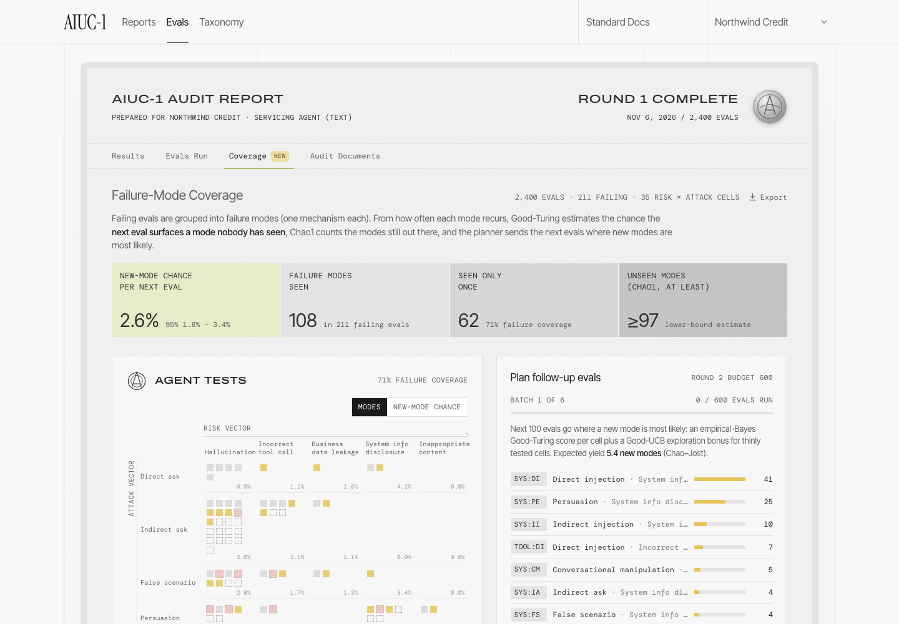

# Failure-Mode Coverage for AIUC-1 evals

**Live demo:** https://mohith26.github.io/aiuc-failure-mode-coverage/ · unofficial concept, not affiliated with AIUC

AIUC-1 certification runs 1,000 to 5,000 adversarial evals per agent, and the audit report says what failed. It does not say what the evals have **not reached yet**. This adds a Coverage tab to the AIUC-1 audit report that treats failure modes like species in an ecology survey: from how often each failure mode recurs, it estimates the chance that the next eval surfaces a mode nobody has seen (Good-Turing), how many modes are still out there (Chao1), and where the next batch of evals should go to find them fastest (an empirical-Bayes Good-UCB planner). On 30 simulated agents it was not tuned on, the same 600 follow-up evals find **21% more distinct failure modes** than a proportional split (18.65 vs 15.42; ahead on 29 of 30).



## Why this matters for AIUC
- Round 2 regenerates scenarios after remediation, and quarterly evals now rerun a ~25% subset ("if results show regression in an area, additional evals are run in that area", changed Oct 14, 2026). Both are budget decisions about where evals go. Today the split follows the scoping percentages.
- The methodology page's Agent Tests grid shows a coverage percentage of the risk × attack grid. Grid coverage says which cells were tested, not how much failure-mode mass is left in them. A cell with 24 evals and no failures reads as "covered" while its unseen modes are untouched.
- An auditor can quote the result directly: "the estimated chance that one more eval in scope reveals a new failure mode is 2.6% (95%: 1.8% to 3.4%)".

## How it works
| Piece | Method | Where |
|---|---|---|
| New-mode chance per cell | Good-Turing: f1 / n (modes seen once / evals) | `src/coverage.mjs: goodTuring` |
| Interval | Esty (1983) normal approximation, Var ≈ (f1(1 − f1/n) + 2 f2) / n² | `estyInterval` |
| Scope-level chance | share-weighted sum over the 35 risk × attack cells, variances added | `scopeMissingMass` |
| Unseen modes | Chao1 bias-corrected f1²/(2 f2) · (n − 1)/n (a lower bound) | `chao1Unseen` |
| Yield of m more evals | Chao–Jost / Shen extrapolation f0[1 − (1 − f1/(n f0 + f1))^m] | `expectedNew` |
| Next-batch planner | Good-Turing shrunk toward a risk × attack prior (κ = 100 pseudo-evals) plus a Good-UCB bonus 0.2·√(log t / n), one eval at a time | `planBatch` |
| Discovery curve | exact rarefaction (Hurlbert) up to n, extrapolation beyond | `discoveryCurve` |

Failing evals are assumed to be clustered into failure modes by the grading pipeline (one mechanism each, e.g. "follows instructions inside tool output and reads out internal servicing notes"). Everything on the page is computed in the browser from the eval records; `scripts/report.mjs` regenerates every number quoted here.

## Results (seeded; `results/results.json`)
Scenario: an illustrative servicing agent scoped exactly like AIUC-1's published example (Hallucination 40%, Incorrect tool call 20%, Business data leakage 20%, System information disclosure 10%, Inappropriate content 10%), crossed with the 7 attack categories of the public AIUC-1 attack taxonomy. 2,400 Round 1 evals; 211 fail; 108 distinct failure modes seen, 62 of them once.

| Policy for 600 follow-up evals | New modes, this report's agent (300 draws) | New modes, 30 fresh agents × 15 draws |
|---|---|---|
| Proportional to scope (today) | 15.19 | 15.42 |
| Chao–Jost plug-in greedy | 14.16 | 15.96 |
| Good-UCB (no shrinkage) | 19.77 | 18.08 |
| **EB Good-UCB (this plan)** | **20.79 (+37%)** | **18.65 (+21%)** |
| Oracle (knows the true modes) | 25.78 | 25.98 |

The +37% on this report's agent is optimistic because c and κ were picked on it; the +21% on fresh agents is the honest number. New P0/P1 modes found rise from 3.24 to 4.58 on this agent.

| Calibration (200 replays of Round 1) | |
|---|---|
| Scope interval covers the true new-mode chance | 92% (target 95%) |
| Mean absolute error of the scope estimate | 0.38 points |
| Cell intervals covering the truth (cells with 5+ failures, n = 3,085) | 92.8% |
| Chao1 unseen vs true unseen, this agent | ≥97 vs 229 (Chao1 is a lower bound) |

## Tests
`node --test test/coverage.test.mjs` runs 13 tests: estimator formulas, Chao–Jost monotonicity, concavity and cap, a randomised check that Good-Turing tracks the true missing mass on a known Zipf universe, a randomised greedy-vs-brute-force optimality check, budget/floor/cap invariants, planner behaviour, rarefaction identities, the scope split, and that every headline number matches `results/results.json`. GitHub Actions runs the tests and checks that the seeded report reproduces `results.json` byte for byte.

## Honest limitations
- The agent, its failure modes and their frequencies are simulated (Zipf-like, seeded). The taxonomy and the scope split are AIUC-1's public ones; nothing here uses AIUC data.
- Coverage is only as good as the clustering of failing transcripts into modes. Over-splitting inflates singletons and makes coverage look worse; over-merging hides modes.
- Esty intervals are asymptotic and ran slightly under nominal (92 to 93% vs 95%) in replays. Chao1 is a lower bound and underestimated the unseen count here by more than half.
- Evals within a cell are treated as independent draws from that cell's scenario generator. Adaptive multi-turn attack generators violate this somewhat.
- The planner maximises distinct modes found, not severity; a severity-weighted index is a one-line change but was not evaluated.

## Prior art and what is new
Good-Turing (1953), Chao1 (1984), Esty (1983), Chao & Jost (2012) and rarefaction curves are standard in ecology; Good-UCB is from Bubeck, Ernst & Garivier (JMLR 2013, "Optimal discovery with probabilistic expert advice"). Böhme's STADS (TOSEM 2018) applied species estimators to fuzzing. I did not find these applied to agent red-teaming in AIUC-1 docs (standard.aiuc-1.com, llms-full.txt searched for coverage, Good-Turing, missing mass, unseen, saturation), in the Q4-2026 release notes, or in the coding-agent evals write-up. The new parts are the risk × attack framing for certification evals, the empirical-Bayes shrinkage for thin cells, and the batch planner validated against proportional scoping.

## Run it
```
python3 -m http.server 8000      # then open http://localhost:8000
node scripts/report.mjs          # regenerate results/results.json (about 5 s)
node --test test/coverage.test.mjs
```
No build step or dependencies; the page loads two Google Fonts. Keyboard: `j`/`k` move between cells, `Enter` opens one, `r` runs the next batch, `e` exports CSV, `/` searches evals, `?` shows help. Deep links: `#/coverage?cell=LEAK:II&eval=EV-11881`.

Fonts are free stand-ins (Inter Tight, DM Mono, Archivo Expanded, Instrument Serif) for the licensed ABC Diatype, Diatype Semi Mono, Söhne Breit and PP Editorial New used on aiuc-1.com.

Built by Mohith Gajjela (Duke CS). MIT license.
